# ifpretty

Prettify and **enrich** `ifconfig` output. A terminal tool that turns the raw,
cryptic `ifconfig` dump into an aligned, colorized, annotated view — and, on
demand, layers on live system data, a 1‑hour bandwidth graph, run‑to‑run
diffing, and an interactive browser map of your whole network. Built on
[rich](https://github.com/Textualize/rich).

```sh
ifpretty
```

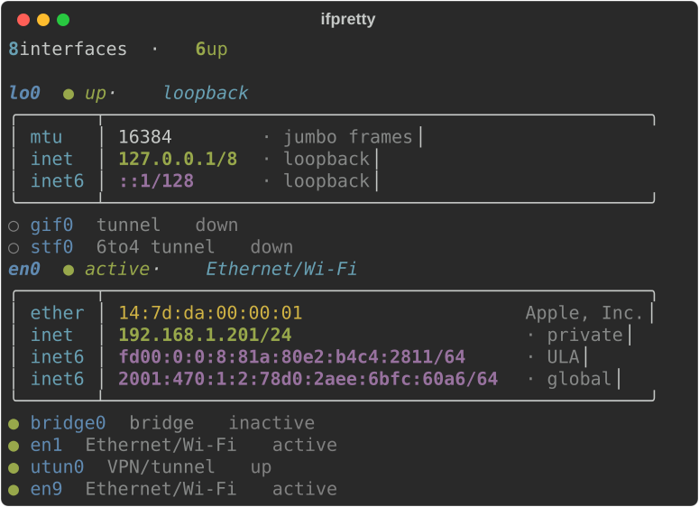

## Install

```sh
pip install ifpretty
```

Requires Python ≥ 3.9. The only runtime dependency is `rich`.

## Quick start

- `ifpretty` — run it bare; it runs `ifconfig` for you and prints the **essentials view**.
- `ifpretty -v` — the full, verbose view (every field).
- `ifconfig | ifpretty` — or pipe `ifconfig` in yourself.
- `ifpretty en0 en6` — limit to specific interfaces.

Flags **compose**, e.g. `ifpretty -l -d` (live data + diff), `ifpretty -t -v` (full table).

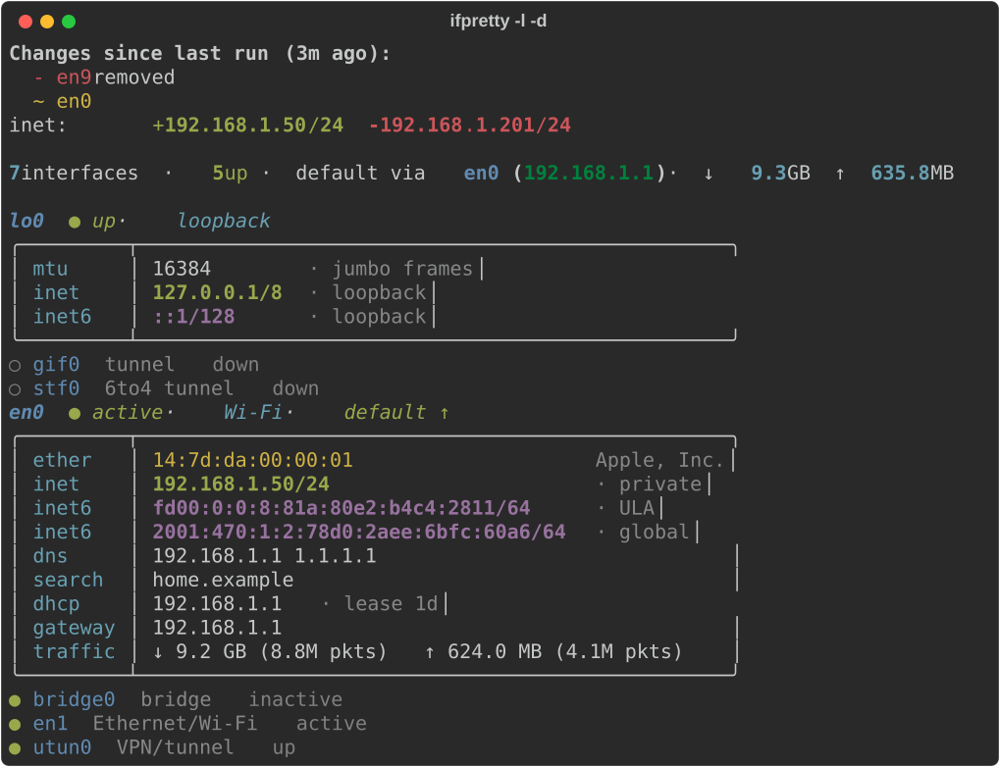

`ifpretty en0 en1` shows only those interfaces:

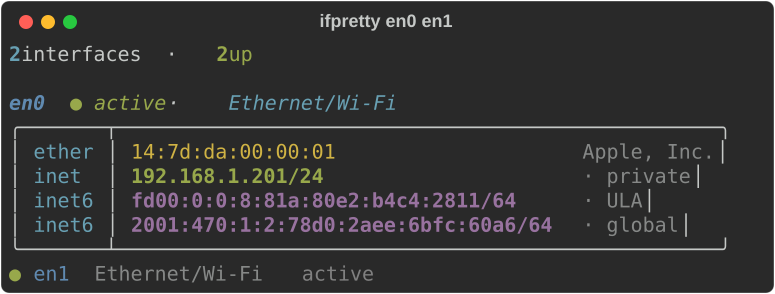

Every picture in this README is a real `ifpretty` run on made-up data
(see [Development](#development)).

---

## Output views

The default reads `ifconfig` from stdin if piped, otherwise runs `ifconfig`
itself (optionally limited to the interface names you pass).

| View | Flag | Best for |
|---|---|---|
| **Essentials** (boxed) | *(default)* | day‑to‑day: identity, routable IPs, gateway, throughput |
| **Verbose** | `-v` / `--verbose` | everything: flags, options, nd6, media, link‑local, bridge config |
| **Records** | `-r` / `--records` | a compact, low‑chrome label/value list |
| **Table** | `-t` / `--table` | one wide table (≤ 240 cols) to scan many interfaces at once |

The **essentials view** shows each interface's identity, routable addresses (with
scope), gateway and throughput, and **collapses down / address‑less interfaces to
a single dim line** to cut noise. `-v` expands them and shows every field.

**Verbose** (`ifpretty -v`)

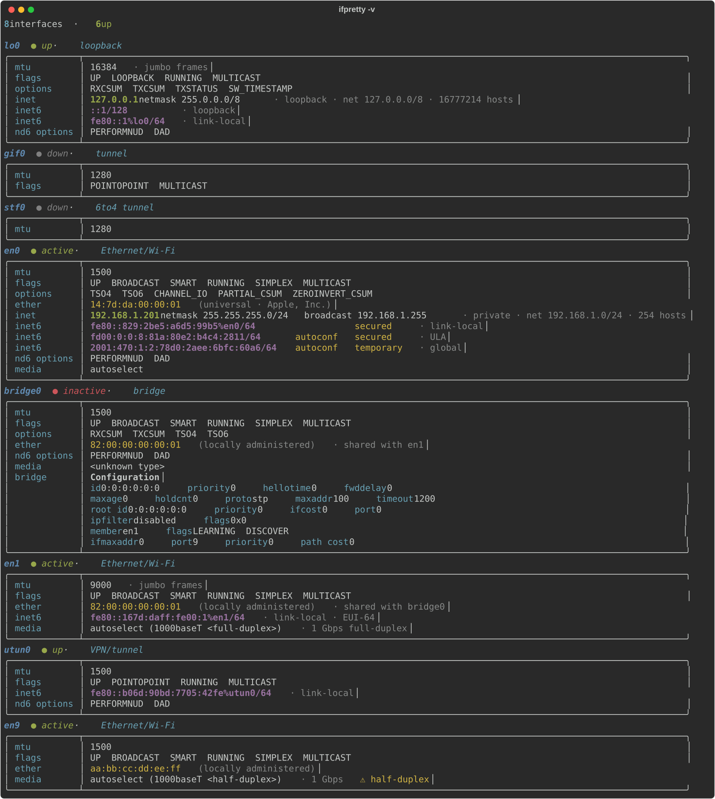

**Records** (`ifpretty -r`)

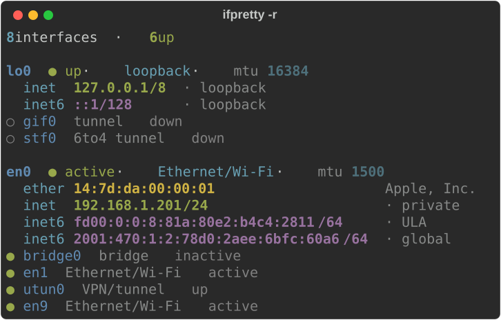

**Table** (`ifpretty -t`)

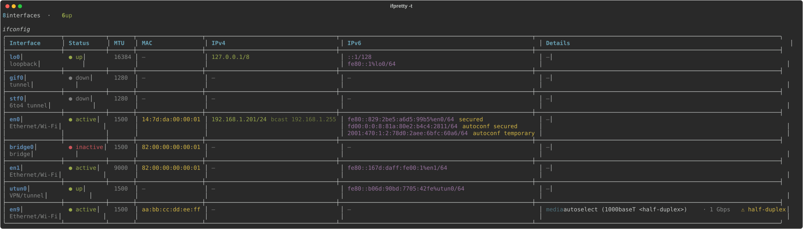

**Linux** (`ifconfig` from net-tools; RX/TX counters show without `--live`)

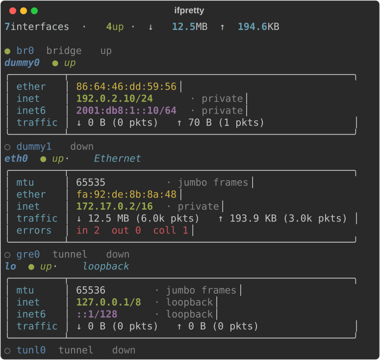

---

## Always‑on enrichment (offline, no network)

Every view annotates what `ifconfig` leaves cryptic — all derived locally, no
network calls:

- **Interface role** — loopback / Ethernet·Wi‑Fi / VPN·tunnel / bridge / AWDL / …
- **IP scope** for each address — `loopback` / `link-local` / `ULA` / `private` /
  `global`; IPv4 also shows the **network + usable‑host count**.
- **MAC** kind (universal vs **locally‑administered/random**), **OUI vendor**
  (from a bundled IEEE registry — no network), **shared‑MAC** notes (e.g. bridge
  members sharing an address), and **EUI‑64** detection.
- **Media** speed/duplex, with a ⚠ warning on **half‑duplex**; **jumbo / sub‑1280
  MTU** notes.
- Decoded **flag / option / nd6** bitfields; IPv6 attributes aligned into columns.
- A one‑line **overview** (interface count, default route, traffic totals).

In the pictures above: the OUI vendor next to each MAC (`Apple, Inc.`), the
scope of each address (`private`, `ULA`, `global`), `jumbo frames` on a big
MTU and the `⚠ half-duplex` warning in the table.

---

## Live system data — `-l` / `--live` (macOS, Linux)

Cross‑references the running system and adds, per interface:

- **default route + gateway**, **friendly hardware‑port names** (e.g. "Wi‑Fi"),
- **DNS servers + search domains**, **DHCP server + lease**,
- **traffic counters** (bytes **and** packets) and **error / collision counts**.

On Linux it reads `/proc/net/route`, `/proc/net/dev` and `/etc/resolv.conf`
(no extra tools, so it works in slim containers): default route, gateway,
counters and DNS. Port names and the DHCP lease are macOS‑only.

```sh
ifpretty -l
```

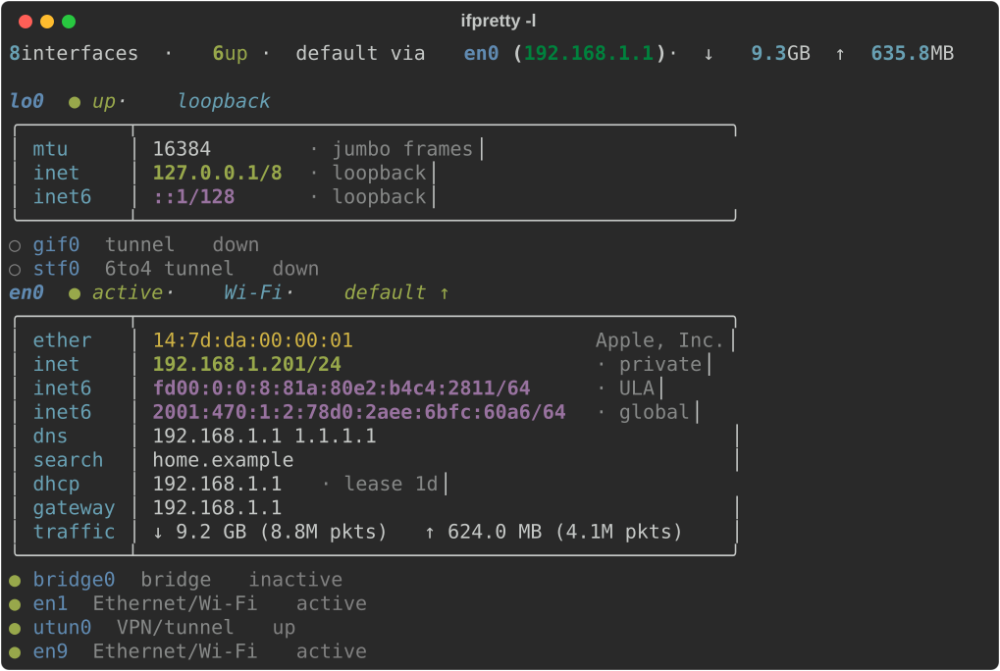

## Gateway health — `-c` / `--check` (macOS)

Pings the default gateway and reports **latency** (or `unreachable`).

```sh
ifpretty -c
```

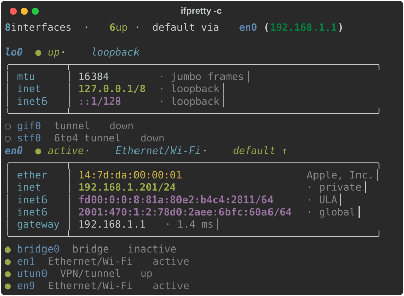

## Public IP — `-w` / `--wan` (opt‑in, external)

Looks up your **public IP + ASN / ISP / geo** via `ipapi.co` and adds it to the
overview line. Strictly opt‑in (it sends your public IP to a third party); the
result is cached ~1 h, times out fast, and degrades silently offline.

```sh
ifpretty -w
```

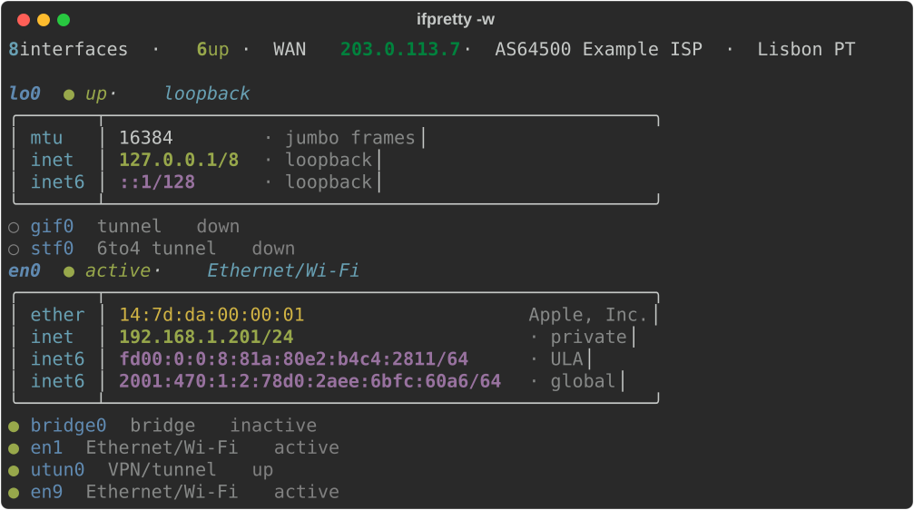

## What changed — `-d` / `--diff`

**Every run records a snapshot** of the *stable* interface state (up/down,
addresses, MAC, mtu, media, gateway — deliberately **not** volatile counters).
`--diff` prints what changed since the previous run before the normal view:

```sh
ifpretty -d
```

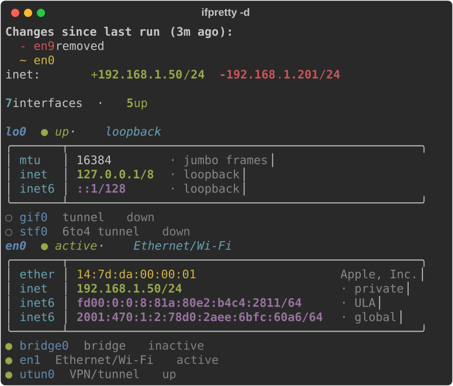

## 1‑hour bandwidth graph — `--record`

`ifconfig` only has cumulative counters, so to graph bandwidth you schedule a
tiny recorder; the per‑interface sparkline + link‑utilization gauge then appear
automatically:

```sh
# once, e.g. in `crontab -e` — use the absolute path:
* * * * * $(command -v ifpretty) --record
```
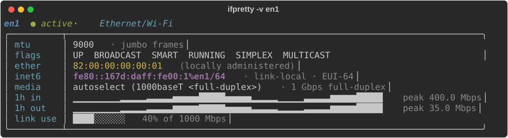

## Network map — `--map`

Opens an **interactive browser graph** of your whole network in three zones:

> **💻 Your computer** (interfaces) · **🏠 Local network** (gateway + LAN
> devices/peripherals from the ARP table) · **🌐 Internet** (the **traceroute
> path** out to the target).

```sh
ifpretty --map            # default target 1.1.1.1
ifpretty --map 8.8.8.8    # trace to a specific target
```

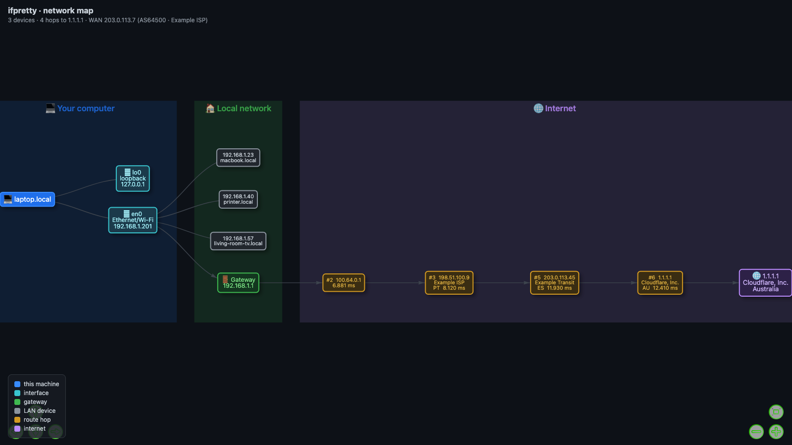

**Every IP is enriched** with everything useful:

- **host** — reverse‑DNS name (e.g. a hop's `core.isp.net`, a printer's `hp.local`)
- **company / org**, **ISP**, **ASN** (e.g. `AS13335 Cloudflare`), **country / city**
- LAN devices also show their **OUI vendor** (maker) and MAC.

Public IPs (hops + target) are resolved in a **single batched whois/geo lookup**;
LAN IPs get local reverse‑DNS. Hover any node for the full detail; node labels show
the company + country inline. Rendered with
[vis-network](https://visjs.github.io/vis-network/) (loaded from a CDN) into a
self‑contained HTML file that opens automatically.

## Legend — `-x` / `--explain`

Appends a legend explaining every flag / option / nd6 bit seen in the output.

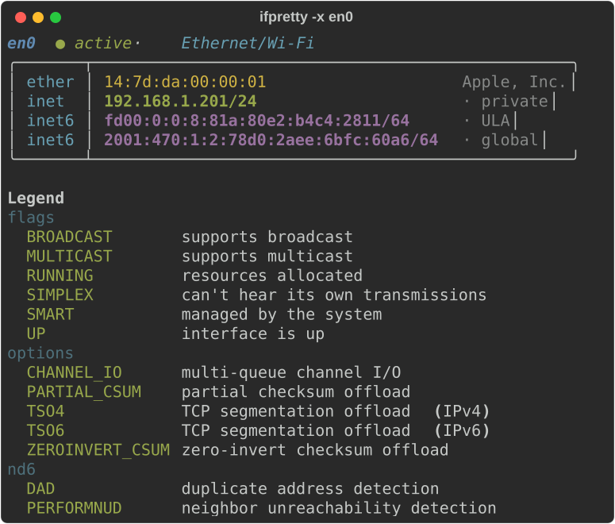

## Refresh vendor DB — `--update-oui`

Downloads the latest IEEE OUI registry into the cache (overrides the bundled
copy used for MAC → vendor lookups). If Python cannot verify the TLS
certificate (older macOS `/etc/ssl/cert.pem` lacks a root the Keychain trusts),
it retries with `curl`, which uses the Keychain.

---

## All flags

| Flag | Does |
|---|---|
| *(none)* | essentials view; runs `ifconfig` if nothing is piped |
| `-v`, `--verbose` | show every field; expand collapsed interfaces |
| `-r`, `--records` | compact label/value layout |
| `-t`, `--table` | single wide table (≤ 240 cols) |
| `-l`, `--live` | route, traffic, DNS (macOS, Linux); names, DHCP (macOS) |
| `-c`, `--check` | ping the default gateway (macOS) |
| `-w`, `--wan` | public IP / ASN / geo (opt‑in, external) |
| `-d`, `--diff` | show changes since the previous run |
| `-x`, `--explain` | append a flag/option legend |
| `--map [TARGET]` | interactive browser network map (default target `1.1.1.1`) |
| `--record` | sample byte counters and exit (for the 1h graph) |
| `--update-oui` | refresh the IEEE vendor database and exit |
| `interfaces…` | limit to these interface names |

## Environment

- `NO_COLOR=1` disables color; `CLICOLOR_FORCE=1` forces it when piped.
- `IFPRETTY_HISTORY` — bandwidth‑samples file (default `~/.cache/ifpretty/samples.csv`).
- `IFPRETTY_CACHE` — cache dir for the WAN lookup, refreshed OUI DB, and the diff
  snapshot (default `~/.cache/ifpretty/`).

The parsing, formatting and offline enrichment read both **macOS** `ifconfig`
and **Linux** net‑tools `ifconfig` (Debian/Ubuntu/Fedora `net-tools` 2.x; on
Linux the RX/TX counters show without `--live`). `--live` works on macOS and
Linux; `--check` / `--record` rely on macOS tools (`route`, `netstat`, `ping`)
and no‑op elsewhere. `--wan` and `--map`'s IP lookup need internet and fail
gracefully without it.

## Architecture

One responsibility per module:

| Module | Responsibility |
|---|---|
| `model` | dataclasses `Inet` / `Inet6` / `Interface` |
| `parse` | raw `ifconfig` text → interface model |
| `enrich` | derivations, OUI, system (`--live`/`--check`), history, `--wan`, snapshot/diff |
| `formatting` | model values → styled (rich‑markup) strings; layout field rows |
| `render` | render strategies (boxed / records / table) + overview / legend / diff |
| `topology` | `--map`: traceroute + ARP + per‑IP whois/rDNS → vis‑network graph |
| `cli` | acquire input → parse → enrich → render |

Dependency direction: `model ← parse, enrich ← formatting ← render ← cli` (no cycles).

## Development

```sh
python3 -m unittest discover -s tests   # 70 tests (snapshot + unit)
ruff check src tests && mypy src
```

Layout snapshots are pinned to golden files; regenerate intentionally with
`REGEN=1 python3 tests/test_ifpretty.py`.

The README pictures come from `docs/make_images.py` (macOS): it runs the real
CLI with a fake `ifconfig`, fake `route`/`netstat`/`scutil`/`ipconfig`/`ping`
and a seeded cache, so no address of your machine ends up in an image. CI
regenerates the SVGs and fails when they are out of date.

```sh
uv run python docs/make_images.py             # SVGs + the --map PNG (needs Chrome)
uv run python docs/make_images.py --svg-only  # SVGs only, what CI checks
```

## License

MIT
